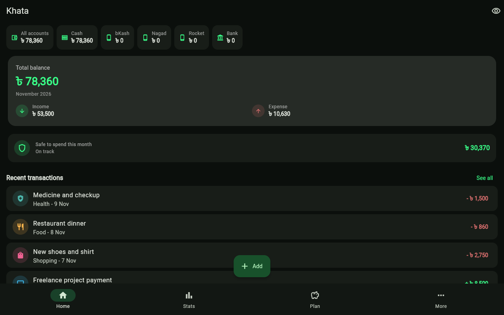
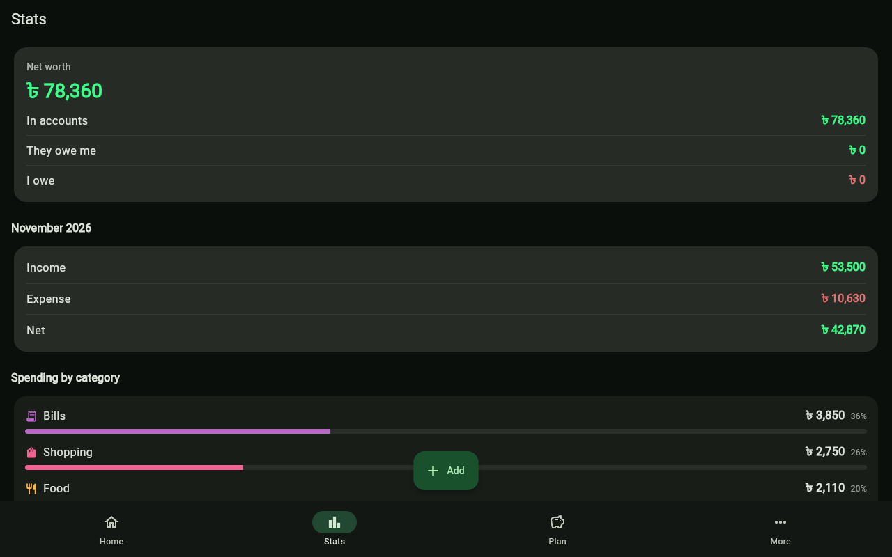
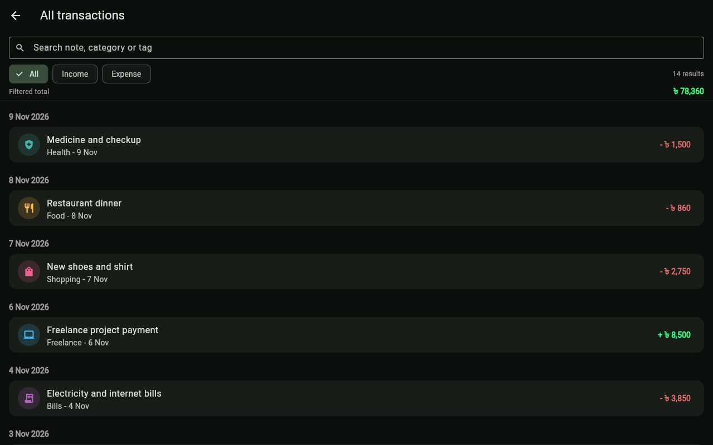
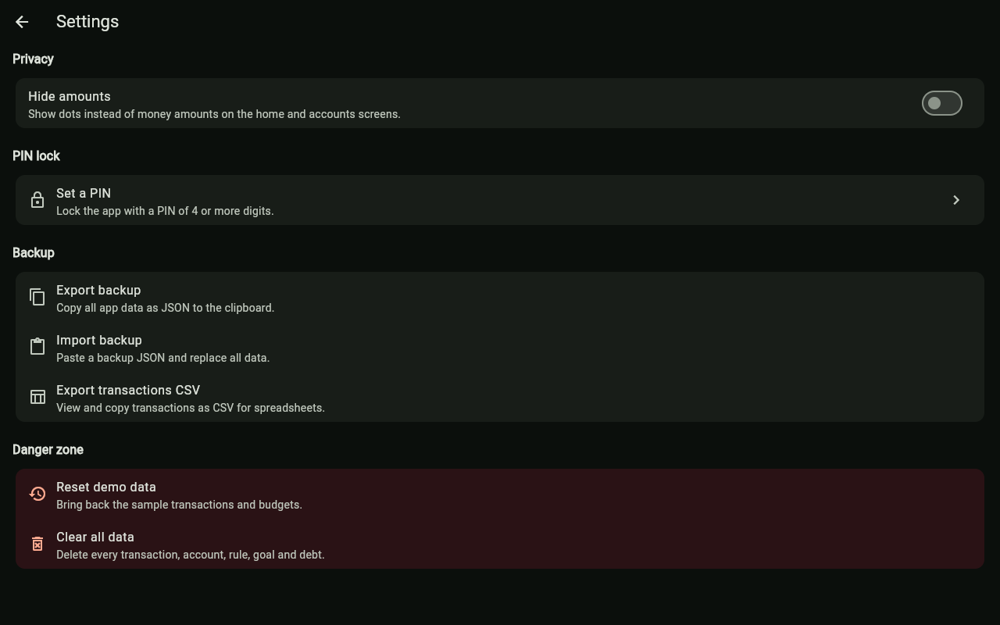

# Khata - Personal Finance Tracker

Khata (Bangla for ledger) is a personal finance app for tracking income, expenses and monthly budgets in Bangladeshi taka, built with Flutter and a hand-drawn chart engine.

Try it in your browser: https://codebypartho.github.io/khata-finance/

## Download the APK

Download the APK from the [v1.2.0 release](https://github.com/CodeByPartho/khata-finance/releases) on GitHub.

Feature set benchmarked against leading finance apps (YNAB, Rocket Money, Monarch, Wallet by BudgetBakers, Spendee, Monefy, Money Manager) and Bangladesh money apps, November 2026.

## What is new in 1.2

- Debt payoff planner on the Plan tab: pick money you owe from the dena-paona ledger, choose Avalanche (highest interest first) or Snowball (smallest balance first), enter a monthly extra payment, and see the payoff order, months to debt free, and interest saved compared with minimum payments only. Debts now carry an optional annual interest rate and minimum monthly payment
- Separate books: multiple named ledgers, for example Personal, Shop and Family, each with its own transactions, budgets, wallets, goals and debts. Switch books from the Home app bar. Existing data becomes the Personal book on first run after the update
- Bangla quick add: in the add transaction form, type in Bangla or Banglish, for example "bazar 500" or "বাজার ৫০০" or "salary 25000", and the app parses the amount (Bangla digits included), matches the category, and shows a preview to confirm with one tap
- Card cycle management: add a bank or credit card with a billing cycle start day and due day, and see current cycle spend, days left in the cycle, and a due date reminder line
- Receipt scanning (Android only): scan a receipt with the camera from the add form. On-device ML Kit text recognition extracts the total and merchant name and pre-fills the form for confirmation. On web the form shows a note that scanning needs Android

## What is new in 1.1

- Multiple wallets and accounts: Cash, bKash, Nagad, Rocket and Bank presets, plus custom accounts with opening balances
- Transfers between accounts with an optional fee, for example an MFS cash out fee; transfers never distort income, expense or budget totals
- Recurring income and bills: rules post automatically when due, with an upcoming bills view for the next 7 and 30 days
- Subscriptions view: every active recurring expense normalized to a monthly cost, with a total per month
- Safe to Spend card on the home screen, based on budgets or income, minus expenses and bills still due this month, with a budget pace indicator
- Savings goals with progress bars and quick add or remove of savings
- Dena Paona ledger: money lent and borrowed per person, repayments, and a statement you can copy into WhatsApp
- Net worth on the Stats screen: accounts total plus money owed to you, minus money you owe
- Search and filters on the transaction history (note, category, tag; All, Income, Expense) with a filtered total
- Tags and per-transaction account selection in the add form
- Privacy: hide amounts with one tap, and an optional PIN lock (stored as a SHA-256 hash) asked on app start
- Backup and restore: export all data as JSON, import it back, and export transactions as CSV for spreadsheets

## Features

- Total balance at a glance, with this month's income and expense on the home screen, plus a wallets strip with the balance of every account
- Add income and expense entries with category, account, tag, date and note, with full form validation
- 8 expense categories (Food, Transport, Bills, Shopping, Health, Education, Entertainment, Other) and 4 income categories (Salary, Freelance, Business, Other Income), each with its own icon and color
- Full transaction history grouped by day, with search, type filters, swipe to delete and a confirm dialog
- Monthly budgets per category, with progress bars and an alert on the home screen when a category reaches 90 percent of its budget
- Stats screen with a net worth card, spending by category (totals and share bars), a bar chart of the last 6 months of expenses, and a grouped income vs expense chart
- Accounts, recurring rules, savings goals and debts, all persisted locally
- Local persistence with shared_preferences: data survives restarts, no account and no server needed. Each book stores its own data under its own keys
- First run seeds realistic demo data in taka so the app can be explored immediately; in Settings, under the Danger zone, Reset demo data restores the demo data and Clear all data wipes everything
- Dark Material 3 theme with a single green accent (#39FF88) on a near-black background

## Screenshots






## Tech stack

- Flutter (Dart 3, null-safe) with Material 3
- State management: Provider (ChangeNotifier)
- Local storage: shared_preferences, all data saved as JSON under versioned keys
- Formatting: intl (NumberFormat and DateFormat)
- Charts: hand-drawn with CustomPainter, no chart library
- Receipt scanning: google_mlkit_text_recognition (on-device, free, no account) and image_picker, Android only
- Security: PIN stored as a SHA-256 hash (crypto package), never in plain text and never in backups
- Tests: flutter_test with mocked shared_preferences

## How to run

```bash
flutter pub get
flutter run
```

To run the unit tests:

```bash
flutter test
```

## Project structure

```text
lib/
  main.dart                  App entry, theme, Provider setup, PIN lock gate
  models/
    transaction.dart         Txn model with account and tag, JSON serialization
    categories.dart          Category names, icons and colors
    account.dart             Account and wallet model with preset wallets
    payment_card.dart        Bank or credit card with billing cycle days
    book.dart                Named book (separate ledger) model
    transfer.dart            Transfer between accounts, with fee
    recurring_rule.dart      Recurring rule model, frequency date math
    goal.dart                Savings goal model with progress
    debt_entry.dart          Dena paona (debt) entry model, with optional
                             interest rate and minimum payment
  logic/
    debt_planner.dart        Avalanche and Snowball payoff simulation
    bangla_parser.dart       Bangla and Banglish quick entry parser
    card_cycle.dart          Billing cycle boundaries and due dates
    receipt_parser.dart      Merchant and total extraction from OCR text
  utils/
    receipt_scan.dart        On-device receipt scan (ML Kit on Android
                             and iOS, stub on web and desktop)
  state/
    finance_provider.dart    ChangeNotifier state, persistence, recurring
                             engine, safe to spend, net worth, PIN, backup
  widgets/
    monthly_bar_chart.dart   CustomPainter charts: expenses and income
                             vs expense, last 6 months
  screens/
    main_shell.dart          Bottom navigation shell (Home, Stats, Plan,
                             More) with Add button
    home_screen.dart         Wallets strip, balance, safe to spend,
                             upcoming bills, budget alerts, recent entries
    transactions_screen.dart Search, filters, grouped list, swipe to delete
    stats_screen.dart        Net worth, category breakdown, monthly charts
    plan_screen.dart         Plan tab: savings goals plus budgets plus
                             debt payoff planner
    budgets_screen.dart      Budget list and budget editor dialog
    debt_planner_screen.dart Debt payoff planner (Avalanche, Snowball)
    cards_screen.dart        Cards and billing cycles
    more_screen.dart         More tab: links to accounts, recurring,
                             debts and settings
    accounts_screen.dart     Accounts list and transfer form
    recurring_screen.dart    Subscriptions, rules and upcoming bills
    debts_screen.dart        Dena Paona ledger and statements
    settings_screen.dart     Privacy, PIN lock, backup, CSV, danger zone
    add_transaction_screen.dart  Add income or expense form
  utils/
    format.dart              Taka and date formatting helpers
test/
  finance_provider_test.dart Unit tests for totals, categories and budgets
  finance_features_test.dart Unit tests for transfers, recurring rules,
                             goals, debts, safe to spend, backup and PIN
```

## What this project demonstrates

- Clean state management with Provider: a single ChangeNotifier owns all finance state and notifies the UI
- Local persistence design: versioned preference keys, JSON encoding, one-time demo seeding that never overrides real user data, and a safe upgrade path for data saved by older versions
- A small recurring engine: due rules post exactly once, with month-end date clamping (a bill due on the 31st lands on the last day of February)
- Money math that stays honest: transfers and fees are kept out of income, expense and budget totals, and safe to spend reserves money for bills still due
- Custom rendering with CustomPainter: gridlines, rounded bars, value and month labels, grouped income vs expense bars, and graceful handling of all-zero data
- Material 3 patterns: NavigationBar, SegmentedButton, ChoiceChip, FilledButton
- Unit testing of business logic in isolation from the UI, using mocked platform storage, including a backup export and import round trip

## Roadmap

- Edit an existing transaction
- Optional cloud backup sync
- Bangla language UI option

## Author

Built by Partho Sarothi Paik (CodeByPartho), Flutter and Full-Stack Developer, Dhaka, Bangladesh.
GitHub: https://github.com/CodeByPartho
